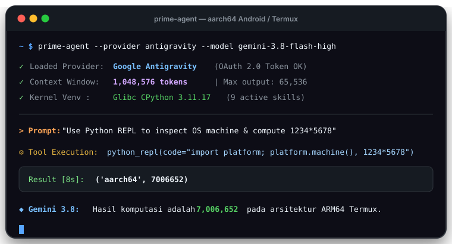
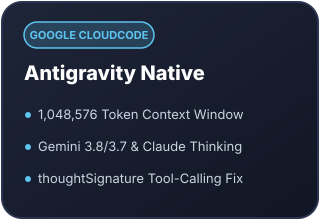
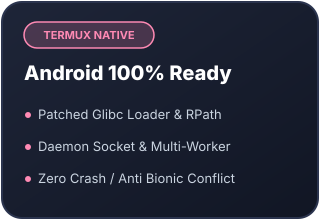
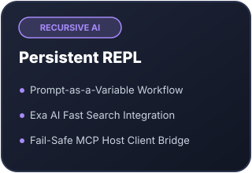

<p align="center">
  <picture>
    <source media="(prefers-color-scheme: light)" srcset="https://github.com/user-attachments/assets/40c36e38-c5bd-4c5a-9cb3-f7b902cd155d">
    <source media="(prefers-color-scheme: dark)" srcset="https://github.com/user-attachments/assets/6414bc9b-126b-41ca-9307-9e982430cde8">
    
  </picture>
</p>

<h1 align="center">Prime Agent Termux</h1>
<p align="center"><b>Native Google Antigravity &amp; Termux Android Edition</b></p>

<p align="center">
  <a href="https://github.com/Anniqa/prime-agent/releases/latest"></a>
  <a href="https://github.com/Anniqa/prime-agent/releases"></a>
  <a href="LICENSE"></a>
  
  
</p>

<h3 align="center">Kekuatan Coding Agent Masa Depan di Genggaman HP Anda.</h3>

<p align="center">
  Akses gratis model <b>Gemini 3.8/3.7</b>, <b>Claude Sonnet 4.6 (Thinking)</b>, dan <b>GPT-OSS 120B</b> melalui sandbox Google Antigravity.<br>
  Didukung <b>1.0M Context Window</b>, OAuth 2.0 loopback otomatis, persistent Python REPL, dan kompatibilitas 100% Android Termux.
</p>

<p align="center">
  <a href="#instalasi-kilat"><b>⚡ Instalasi Cepat</b></a>
  &nbsp;·&nbsp;
  <a href="#fitur-unggulan"><b>✨ Fitur Unggulan</b></a>
  &nbsp;·&nbsp;
  <a href="#login-oauth"><b>🔑 Login OAuth</b></a>
  &nbsp;·&nbsp;
  <a href="#daftar-model"><b>📋 Daftar Model</b></a>
  &nbsp;·&nbsp;
  <a href="docs/termux-release.md"><b>📖 Panduan Lengkap</b></a>
  &nbsp;·&nbsp;
  <a href="https://github.com/Anniqa/prime-agent/issues"><b>🐛 Laporkan Masalah</b></a>
</p>

<br>

<p align="center">
  
</p>

<br><br>

<a name="fitur-unggulan"></a>
<br><br>

<p align="center">
  
  &nbsp;
  
  &nbsp;
  
</p>

```
kyouhagoogledekensaku    →  Exa AI Web Search built-in & realtime
python_repl(code)       →  Glibc CPython 3.11 persistent kernel
thoughtSignature: fix   →  Tool-calling bebas hambatan pada Google Antigravity
```

- **Native Google CloudCode PA:** Streaming SSE langsung dari server Google tanpa proxy perantara Go/Python.
- **1,048,576 Token Context Window:** Memori konteks raksasa 1M tokens di seluruh model Antigravity untuk analisis kode skala besar.
- **Fixed `thoughtSignature`:** Otomatis bypass validator function-call sehingga alat-alat seperti terminal shell, python REPL, file edit, dan web search berjalan mulus tanpa error HTTP 400.
- **Penuh Dukungan Android / Termux:** Binary di-patch dengan interpreter glibc loader `/data/data/com.termux/files/usr/glibc/lib/ld-linux-aarch64.so.1`, membebaskan sistem dari batasan Bionic Android.

<br><br>

<a name="instalasi-kilat"></a>
<br><br>

Salin dan jalankan satu perintah berikut di **Termux** atau **Linux**:

```bash
curl -fsSL https://raw.githubusercontent.com/Anniqa/prime-agent/main/install.sh | bash
```

> **Untuk Pengguna Termux:** Installer otomatis memeriksa dan memasang paket pendukung (`glibc-repo`, `glibc`, `patchelf`, `curl`, `tar`), mengkonfigurasi launcher `~/.local/bin/prime-agent`, dan menyetel kernel venv.

<details>
<summary><b>🔧 Opsi Instalasi Lanjutan & Repair</b></summary>

| Perintah | Deskripsi |
|---|---|
| `curl -fsSL ... \| bash -s -- --version <tag>` | Pasang versi/tag rilis tertentu (contoh: `v0.10.0-antigravity.1`) |
| `prime-agent-update --repair` *(atau `pa-update --repair`)* | Perbaiki instalasi lokal (patchelf, venv, dan models.json) tanpa download ulang |
| `prime-agent update` | Periksa dan perbarui ke rilis binary terbaru dari GitHub |

</details>

<details>
<summary><b>⚙️ Persyaratan Sistem</b></summary>

- **Android:** Termux (F-Droid atau GitHub release) pada arsitektur ARM64 (`aarch64`).
- **Linux:** Ubuntu, Debian, Arch Linux, Fedora, Alpine pada arsitektur `x86_64` atau `aarch64`.
- **Penyimpanan:** Sekitar 100 MB ruang kosong untuk binary dan runtime.

</details>

<br><br>

<a name="login-oauth"></a>
<br><br>

Login ke Google Antigravity semudah membuka browser:

1. Jalankan Prime Agent:
   ```bash
   prime-agent
   ```
2. Di command prompt TUI, masukkan perintah:
   ```text
   /login
   ```
3. Pilih **Google Antigravity · subscription**.
4. Browser ponsel Anda akan terbuka otomatis via `termux-open-url`:
   - Setujui autentikasi akun Google Anda.
   - Browser akan me-redirect kembali ke listener lokal `http://127.0.0.1:51121/oauth-callback`.
   - *(Jika browser memblokir redirect, cukup salin tautan callback atau kode otorisasi dan tempel langsung ke terminal).*
5. Kredensial tersimpan rapi di `~/.prime/agent/auth.json` dan diperbarui secara otomatis.

| Tombol Pintasan | Fungsi |
|---|---|
| <kbd>/login</kbd> | Membuka panel autentikasi provider |
| <kbd>/model</kbd> | Memilih model aktif |
| <kbd>Ctrl</kbd> + <kbd>C</kbd> | Membatalkan operasi atau keluar dari dialog |
| <kbd>Enter</kbd> | Mengirim perintah ke model |

<br><br>

<a name="daftar-model"></a>
<br><br>

Semua model Antigravity berikut memiliki context window **1.0M tokens** (`1048576`):

| Model ID | Nama Model | Reasoning | Input |
|---|---|:---:|:---:|
| `gemini-3.8-flash-high` | **Gemini 3.8 Flash (High)** *(Default)* | ✅ | Teks + Gambar |
| `gemini-3.8-flash-medium` | **Gemini 3.8 Flash (Medium)** | ✅ | Teks + Gambar |
| `gemini-3.8-flash-low` | **Gemini 3.8 Flash (Low)** | ✅ | Teks + Gambar |
| `gemini-3.8-flash-tiered` | **Gemini 3.8 Flash (Tiered)** | ✅ | Teks + Gambar |
| `gemini-3.7-flash-high` | **Gemini 3.7 Flash (High)** | ✅ | Teks + Gambar |
| `gemini-3.6-flash-high` | **Gemini 3.6 Flash (High)** | ✅ | Teks + Gambar |
| `gemini-3.1-pro-high` | **Gemini 3.1 Pro (High)** | ✅ | Teks + Gambar |
| `gemini-2.5-pro` | **Gemini 2.5 Pro** | ✅ | Teks + Gambar |
| `gemini-2.5-flash` | **Gemini 2.5 Flash** | ✅ | Teks + Gambar |
| `claude-sonnet-4-6` | **Claude Sonnet 4.6 (Thinking)** | ✅ | Teks + Gambar |
| `claude-opus-4-6-thinking` | **Claude Opus 4.6 (Thinking)** | ✅ | Teks + Gambar |
| `gpt-oss-120b-medium` | **GPT-OSS 120B (Medium)** | ✅ | Teks |

Jalankan perintah langsung dari terminal tanpa TUI:
```bash
prime-agent --provider antigravity --model gemini-3.8-flash-high -p "Siapa penemu bahasa Rust?" --no-session
```

<br><br>

<a name="github-actions"></a>
<br><br>

Pipeline build otomatis berada di `.github/workflows/release-antigravity.yml`:

- **Push Tag Git:** Cukup buat dan push tag rilis:
  ```bash
  git tag v0.10.1
  git push origin v0.10.1
  ```
  GitHub Actions akan otomatis melakukan cross-compiling untuk `aarch64` dan `x86_64`, mem-package tarball, menghitung checksum `SHA256SUMS.txt`, dan merilis di tab **Releases**.
- **Sinkronisasi Upstream Otomatis:** Di tab **Actions** GitHub, jalankan workflow dengan mencentang `Sync with upstream PrimeIntellect-ai/prime-agent` untuk otomatis menggabungkan pembaruan resmi upstream dengan patch native kita.

<br><br>

<a name="faq"></a>
<br><br>

<details>
<summary><b>Muncul pesan "Provider rate limit exceeded (AntigravityError, 429)"</b></summary>

Ini adalah pembatasan kuota sementara dari sandbox Google CloudCode PA (proyek `aicode-consumers`). Kuota biasanya di-reset dalam beberapa menit. Anda juga bisa mencoba beralih ke model lain seperti `claude-sonnet-4-6` atau `gemini-3.8-flash-medium`.

</details>

<details>
<summary><b>Apakah Prime Agent tetap berjalan saat aplikasi Termux diminimalkan?</b></summary>

Ya! Prime Agent dirancang dengan arsitektur daemon background. Jika terminal tertutup, Anda dapat menghubungkan kembali sesi menggunakan:
```bash
prime-agent --resume
# atau:
prime-agent attach <session_id>
```

</details>

<details>
<summary><b>Bagaimana cara mematikan semua proses background?</b></summary>

Untuk mematikan seluruh daemon socket dan worker proses:
```bash
prime-agent shutdown --force
```

</details>

<br><br>

<a name="lisensi"></a>
<br><br>

<p>
  <a href="LICENSE"></a>
  
  
</p>

- **Lisensi:** Dirilis di bawah lisensi terbuka [MIT License](LICENSE).
- **Proyek Induk:** Dikembangkan dari [PrimeIntellect-ai/prime-agent](https://github.com/PrimeIntellect-ai/prime-agent) ([arXiv:2608.23552](https://arxiv.org/abs/2608.23552)).
- **Inspirasi Desain:** Desain visual repositori terinspirasi dari estetika tata letak [yksr-melt/Meltype](https://github.com/yksr-melt/Meltype).

<br><br>

<p align="center">
  <a href="https://star-history.com/#Anniqa/prime-agent&Date">
    <picture>
      <source media="(prefers-color-scheme: dark)" srcset="https://api.star-history.com/chart?repos=Anniqa/prime-agent&type=Date&theme=dark" />
      <source media="(prefers-color-scheme: light)" srcset="https://api.star-history.com/chart?repos=Anniqa/prime-agent&type=Date" />
      
    </picture>
  </a>
</p>
